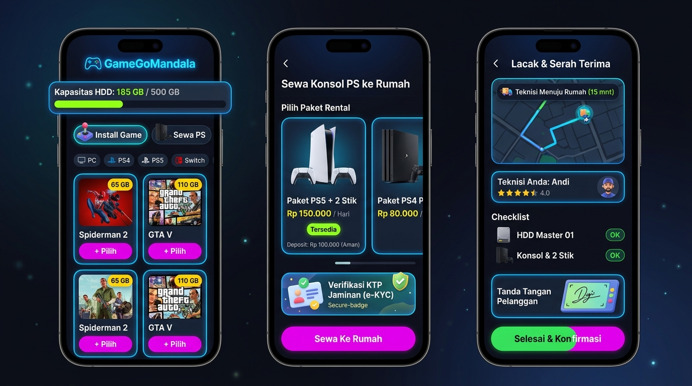

# 🎮 GameGoMandala — Home Service Game Offline & Rental Konsol PS

Aplikasi web full-stack *mobile-first* bertema **"Playful Game-Themed / PS5 Menu Inspired"** untuk katalog, pemesanan, dan manajemen operasional instalasi game offline (PC, PS4, PS5, Nintendo Switch) serta rental konsol PlayStation *door-to-door*.



---

## 🚀 Fitur Unggulan

### 1. Desain Visual & UI/UX (Sesuai Mockup Referensi)
* **Latar Utama:** *Deep Space Dark* (`#0F1016` hingga `#1B1E2B`).
* **Warna Aksen:** Biru Elektrik (*PS5 Pulse Blue*) dengan efek *subtle neon glow border* (`box-shadow` biru menyala).
* **Tombol Aksi (CTA):** Magenta cerah (`#D900FF`) dan gradasi Hijau-ke-Ungu untuk konfirmasi serah terima.
* **3 Layar Utama:**
  1. **Layar 1 (Katalog & Kalkulator Kapasitas):** Header neon logo, widget kapasitas HDD real-time (`185 GB / 500 GB`), progress bar hijau menyala (otomatis merah jika penuh), filter platform (`PC`, `PS4`, `PS5`, `Switch`), dan grid 2 kolom dengan badge ukuran GB kuning.
  2. **Layar 2 (Sewa Konsol PS ke Rumah):** Carousel paket rental (`Paket PS5 + 2 Stik`, `Paket PS4 Pro`, dll), badge harga sewa/hari, badge ketersediaan, widget jaminan e-KYC KTP, dan tombol CTA sewa.
  3. **Layar 3 (Lacak & Serah Terima):** Peta rute taktis gelap dengan status rute teknisi (15 mnt), kartu profil teknisi Andi (rating bintang & kontak WA), checklist kelengkapan barang, kanvas **Tanda Tangan Digital Pelanggan (HTML5 Canvas)**, dan tombol konfirmasi akhir bergradasi hijau-ke-ungu.

### 2. Multi-Role RBAC (Hak Akses Pengguna)
* **Mode Pelanggan (Guest & Customer):**
  * Browsing katalog game & rental PS tanpa perlu login.
  * Kalkulator kapasitas HDD/SSD otomatis di sisi browser.
  * Simulasi ongkir otomatis per KM berdasarkan jarak dari toko.
  * Upload foto screenshot `dxdiag` / info memori sebelum teknisi berangkat.
  * Form e-KYC upload foto KTP & selfie khusus rental PS.
  * *Countdown timer* masa aktif sewa konsol PS, tombol perpanjang sewa, tombol ajukan refund deposit, dan klaim tiket garansi instalasi 7 hari.
* **Dashboard Admin / Pemilik Bisnis:**
  * Ringkasan metrik harian: Estimasi Omzet, Total Pesanan, Unit Konsol Siap, dan Deposit Tertahan.
  * CRUD Katalog Game & Paket Rental PS.
  * Manajemen Inventaris Konsol (Nomor Seri, Fisik, Stik, Kabel) dan Master HDD.
  * Verifikasi e-KYC KTP pelanggan dari Google Drive privat.
  * Manajemen Refund / Pemotongan Denda Deposit dengan *audit trail* tercatat.
  * Pengaturan titik GPS koordinat toko dan tarif ongkir per KM.
* **Dashboard Teknisi Lapangan:**
  * Daftar tugas kunjungan hari ini dan rute sekuensial.
  * *Packing Checklist* otomatis (HDD Master mana dan unit konsol apa yang wajib dibawa).
  * 1-klik buka navigasi rute di Google Maps.
  * Form serah-terima fisik dan tanda tangan digital pelanggan di layar HP.
  * Lapor kendala lapangan (Rumah kosong, mati lampu, spek PC tidak cocok) untuk *reschedule* otomatis.
  * Dompet komisi teknisi dan uang bensin transparan per kilometer.

---

## 🗄️ Skema Database Google Sheets (12 Sheets)

Backend menggunakan Google Sheets sebagai database utama yang diinisialisasi otomatis lewat fungsi `setupDatabase()` di file `backend/Code.gs`:

| No | Nama Sheet | Kolom Header |
|---|---|---|
| 1 | `Katalog_Game` | ID, Nama_Game, Platform, Ukuran_GB, Harga_Paket, Spek_Minimal, Cover_URL |
| 2 | `Katalog_RentalPS` | ID_Paket, Nama_Unit, Harga_Per_Jam, Harga_Per_Hari, Deposit, Status_Ketersediaan, Foto_URL |
| 3 | `Pelanggan` | ID_Pelanggan, Nama, No_WhatsApp, Alamat, Titik_Lokasi_Coords, Spek_Device_Tersimpan |
| 4 | `Pesanan` | ID_Pesanan, ID_Pelanggan, Tipe_Layanan, Item_Dipilih_JSON, Total_GB, Total_Harga, Ongkir, Status_Pesanan, Jadwal_Kunjungan, ID_Teknisi, Timestamp |
| 5 | `Inventaris_Konsol` | Nomor_Seri, Tipe_Konsol, Kondisi_Fisik, Jumlah_Stick, Kelengkapan_Kabel, Status |
| 6 | `DepositJaminan` | ID_Deposit, ID_Pesanan, Nominal_Deposit, Jenis_Dokumen, URL_Foto_KTP_Selfie, Status_Verifikasi_eKYC, Potongan_Denda, Status_Refund, Updated_By, Timestamp |
| 7 | `SewaPS` | ID_Sewa, ID_Pesanan, Nomor_Seri_Konsol, Durasi_Sewa, Waktu_Mulai, Waktu_Selesai, Biaya_Keterlambatan, Denda_Kerusakan |
| 8 | `Jadwal_Teknisi` | ID_Jadwal, ID_Teknisi, Tanggal, Slot_Waktu, ID_Pesanan, Status_Kunjungan, Estimasi_Pengerjaan |
| 9 | `Ongkir` | ID_Zona, Nama_Zona, Jarak_KM, Tarif_Per_KM, Titik_Toko_Coords |
| 10 | `Inventaris_HDD` | Nomor_HDD, Kapasitas_Total, Daftar_Game_Didalamnya, Status_Dibawa |
| 11 | `Pembayaran` | ID_Bayar, ID_Pesanan, Status_Bayar, Metode, URL_Bukti_Bayar, Komisi_Teknisi, Uang_Bensin, Timestamp |
| 12 | `Garansi_Komplain` | ID_Tiket, ID_Pesanan, Masa_Berlaku_Garansi, Deskripsi_Kendala, Jadwal_Kunjungan_Ulang, Status_Tiket, Timestamp |
| 13 | `Promo_Ulasan` | ID_Ulasan, ID_Pesanan, Kode_Promo, Diskon, Rating_Teknisi, Komentar, Timestamp |

---

## 🛠️ Panduan Setup Google Sheets & Google Apps Script (GAS)

### Langkah 1: Buat Spreadsheet Baru
1. Buka [Google Sheets](https://sheets.new) di browser Anda.
2. Beri nama spreadsheet Anda: **Database GameGoMandala**.
3. Salin **Spreadsheet ID** dari URL browser:
   * Contoh URL: `https://docs.google.com/spreadsheets/d/1BxiMVs0XRA5nFMdKvBdBZjgmUUqptlbs74OgvE2upms/edit`
   * Maka ID Spreadsheet Anda adalah: `1BxiMVs0XRA5nFMdKvBdBZjgmUUqptlbs74OgvE2upms`.

### Langkah 2: Buka Google Apps Script Editor
1. Pada menu atas Google Sheets, klik **Extensions (Ekstensi)** > **Apps Script**.
2. Hapus seluruh kode bawaan di `Code.gs`.
3. Buka file [`backend/Code.gs`](backend/Code.gs) dari proyek ini, salin seluruh kodenya, lalu tempelkan (*paste*) ke editor Google Apps Script.
4. Klik tombol **Save (Simpan / Ikon Disket)** atau tekan `Ctrl + S`.

### Langkah 3: Jalankan Inisialisasi Database Otomatis
1. Pada dropdown fungsi di toolbar atas Apps Script, pilih fungsi `setupDatabase`.
2. Klik tombol **Run (Jalankan)**.
3. Google akan meminta izin otorisasi (*Review Permissions*):
   * Pilih akun Google Anda.
   * Klik **Advanced (Lanjutan)** > **Go to Untitled project (unsafe)**.
   * Klik **Allow (Izinkan)**.
4. Tunggu beberapa detik hingga muncul log: *"Database GameGoMandala berhasil diinisialisasi dengan 12 tabel dan data awal!"*.
5. Cek kembali tab Google Sheets Anda: seluruh 12 sheet, kolom header berformat rapi, dan data starter (katalog game, rental PS, konsol, master HDD) sudah langsung terisi!

### Langkah 4: Deploy sebagai Web App API
1. Di kanan atas Google Apps Script, klik tombol biru **Deploy** > **New deployment**.
2. Klik ikon gerigi (Select type) > pilih **Web app**.
3. Isi konfigurasi berikut:
   * **Description:** `GameGoMandala API v1`
   * **Execute as:** `Me (email-anda@gmail.com)` *(Wajib! Agar script memiliki izin menulis ke sheet & Drive)*
   * **Who has access:** `Anyone (Siapa saja)` *(Agar frontend bisa mengirim request tanpa login akun Google)*
4. Klik tombol **Deploy**.
5. Salin **Web App URL** yang dihasilkan (formatnya: `https://script.google.com/macros/s/AKfycbx.../exec`).

### Langkah 5: Sambungkan ke Frontend (.env)
1. Di root folder proyek ini, salin file `.env.example` menjadi `.env`:
   ```bash
   cp .env.example .env
   ```
2. Buka file `.env` dan masukkan Web App URL Anda:
   ```env
   VITE_GAS_WEBAPP_URL=https://script.google.com/macros/s/AKfycbx_MASUKKAN_URL_DEPLOYMENT_ANDA/exec
   VITE_SPREADSHEET_ID=MASUKKAN_SPREADSHEET_ID_ANDA
   ```
3. Simpan file `.env`. Sekarang aplikasi frontend Anda sudah terhubung 100% secara langsung ke Google Sheets & Google Drive!

> **Catatan:** Jika file `.env` belum diisi, aplikasi tetap dapat dijalankan secara instan dengan *Rich Mock Data & LocalStorage*, sehingga seluruh fitur interaktif tetap bisa diuji tanpa konfigurasi awal.

---

## 💻 Menjalankan Aplikasi Secara Lokal

### Prasyarat
* Node.js versi 18 atau yang lebih baru
* npm versi 9 atau yang lebih baru

### Instalasi & Menjalankan Dev Server
```bash
# 1. Install dependencies
npm install

# 2. Jalankan server pengembangan
npm run dev
```

Buka browser di `http://localhost:3000`.

### Mode Tampilan di Aplikasi:
Di header bagian kanan atas, Anda dapat memilih 3 mode tampilan:
* **3 Mockup Layar:** Menampilkan ketiga layar mobile (Katalog, Sewa PS, Lacak Teknisi) berdampingan dalam bingkai iPhone 15 Pro persis seperti pada gambar referensi PRD.
* **Mobile Frame:** Tampilan simulasi satu perangkat mobile iPhone dengan *dynamic island*.
* **Layar Lebar:** Tampilan antarmuka penuh responsif untuk monitor / tablet.

---

## 📂 Struktur Direktori Proyek

```
GameGoMandala/
├── backend/
│   └── Code.gs               # Backend Google Apps Script (12 Sheet DB, Drive Vault, PDF Generator, API)
├── src/
│   ├── components/
│   │   ├── Header.jsx                # Header neon, role switcher (Pelanggan/Admin/Teknisi), view toggle
│   │   ├── KatalogScreen.jsx         # Layar 1: Katalog game & kalkulator kapasitas HDD
│   │   ├── RentalPSScreen.jsx        # Layar 2: Sewa konsol PS ke rumah & e-KYC KTP widget
│   │   ├── TrackingSerahTerimaScreen.jsx # Layar 3: Peta rute, profil teknisi, checklist, kanvas TTD
│   │   ├── MockupShowcase.jsx        # Tampilan 3 layar iPhone berdampingan persis referensi
│   │   ├── CheckoutModal.jsx         # Form checkout, simulator ongkir KM, jadwal kunjungan, dxdiag
│   │   ├── CustomerPortal.jsx        # Countdown masa sewa, perpanjang, refund deposit, tiket garansi
│   │   ├── AdminDashboard.jsx        # Dashboard pemilik bisnis: order, e-KYC, deposit, katalog CRUD
│   │   └── TeknisiDashboard.jsx      # Dashboard kurir: daftar tugas, packing list, Google Maps, dompet
│   ├── data/
│   │   └── mockData.js               # Mock dataset lengkap 12 entitas
│   ├── services/
│   │   └── api.js                    # Konektor Google Apps Script Web App & fallback offline
│   ├── App.jsx                       # State orchestration & root application
│   ├── main.jsx                      # Entrypoint React
│   └── index.css                     # Custom styling, neon glow, and animations
├── index.html                        # HTML5 template dengan Google Fonts (Outfit, Rajdhani, Inter)
├── package.json                      # Konfigurasi dependensi npm
├── tailwind.config.js                # Konfigurasi tema neon game Tailwind CSS
├── vite.config.js                    # Konfigurasi Vite
├── .env.example                      # Template environment variable
└── README.md                         # Dokumentasi lengkap
```

---

## 📄 Lisensi
Hak Cipta © 2026 Mandala Projek. Seluruh hak cipta dilindungi undang-undang.
